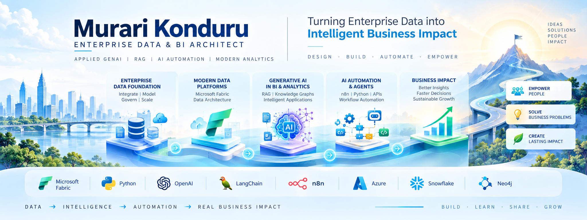

  

<h2 align="center">Murari Konduru</h2>

  <strong>Enterprise Data & BI Architect | Applied GenAI | RAG | AI Automation</strong>

  Solve Business Problems · Empower People · Create Lasting Impact

---

## 🎯 Areas of Focus

- **Enterprise Data & BI:** Power BI, DAX, Microsoft Fabric, data visualization, and analytics architecture
- **Applied GenAI & RAG:** Document intelligence, semantic retrieval, vector databases, and knowledge-grounded assistants
- **Knowledge Graphs:** Entity relationships, graph-based retrieval, and knowledge-driven applications
- **AI Automation:** n8n, Python, API integration, and intelligent workflow automation
- **Solution Architecture:** End-to-end design, integration, testing, and deployment considerations

---

## 🚀 Featured Projects

### 🌾 Tamil Nadu Agriculture Schemes — RAG Assistant
A domain-focused RAG application designed to retrieve information from indexed Tamil Nadu agriculture scheme documents.

**Focus:** PDF ingestion, chunking, embeddings, vector retrieval, and grounded responses.

[Explore repositories](https://github.com/ksmurari1?tab=repositories)

### 🕸️ Tamil Nadu Schemes — Knowledge Graph RAG
An exploration of knowledge graph techniques for representing scheme information and connecting related entities.

**Focus:** Knowledge graphs, Neo4j, Python, data extraction, and graph-based retrieval.

[Explore repositories](https://github.com/ksmurari1?tab=repositories)

### ⚙️ AI Automation with n8n and Python
Practical workflows combining data transformation, conditional logic, automation nodes, and notifications.

**Focus:** n8n, Python, APIs, workflow design, and automation.

[View project](https://github.com/ksmurari1/ai-automation-n8n)

### 📰 News Headlines Scraper
A Python web-scraping project that extracts and cleans the top five unique headlines from BBC News.

**Focus:** Requests, BeautifulSoup, HTML parsing, error handling, and testing.

[View project](https://github.com/ksmurari1/news-headlines-scraper)

---

## 🧰 Technology Stack

**Data & BI:** Power BI · DAX · Power Query · Tableau · Microsoft Fabric

**GenAI & Retrieval:** Python · LangChain · RAG · Embeddings · Vector Stores · Knowledge Graphs

**Automation & Integration:** n8n · REST APIs · Playwright · Python Automation

**Engineering Practices:** Git · GitHub · Testing · Documentation · Architecture Design

---

## 🧭 Engineering Approach

- Start with the business problem and define the solution architecture.
- Build modular, maintainable components.
- Validate retrieval quality, data transformations, and application behaviour.
- Document design decisions, limitations, and implementation steps.
- Evolve prototypes towards reliable, production-aware solutions.

---

## 🤝 Connect

- **GitHub:** [github.com/ksmurari1](https://github.com/ksmurari1)
- **LinkedIn:** [Add your LinkedIn profile URL here](https://www.linkedin.com/)

---

*Building at the intersection of enterprise data, applied AI, and intelligent automation.*
